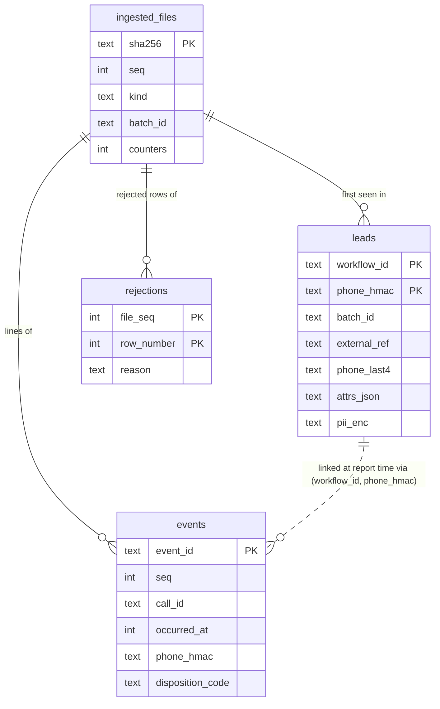

# Submission

## Candidate
- **Name:** Venkatkaushal A
- **Assignment chosen:** A (Data)
- **Time spent (honest estimate):** ~4h (about 1h reading and planning both assignments, ~3h building
  and testing A)

## TL;DR
- `ledger ingest` validates and appends; `ledger report` derives everything from the current DB state.
  That one rule makes events-before-their-lead, drop-by-drop == all-at-once and final orphan counts
  correct by construction.
- SQLite, 5 tables. The interaction ledger is append-only, enforced by DB triggers.
- PII: phone -> keyed HMAC blind index (for joining) + AES-GCM (for recovery); names AES-GCM only.
  No plaintext name or phone anywhere in the DB (tested).
- Idempotent: per-file transaction keyed by content hash. Re-running any drop changes nothing (tested
  byte-for-byte on an unseen seed).
- 64 tests. Stretch done: large scale ingests + reports in ~87s (target < 2 min).
- Extra: `ledger explain` traces any lead back to its ledger rows; `ledger status` / `ledger quarantine` show what is in
  the DB including quarantined events; `ledger shell` for interactive use.

## How to run
From a clean clone (Python 3.11+; tested on 3.14, Windows):
```bash
python -m venv .venv
source .venv/bin/activate            # Windows: .venv\Scripts\activate
pip install -r requirements.txt
pip install -e ./solution            # installs the `ledger` command

python assignment-a-data/tools/generate_data.py --seed 42 --scale small --out data

ledger ingest data/drop_1
ledger ingest data/drop_2
ledger report --out reports/

ledger status                                  # what is in the DB, incl. quarantined events
ledger quarantine                              # every quarantined event + reason -> reports/quarantine.csv
ledger explain motor_renewal MOT/2026/100133   # why a lead is in its bucket, event by event
ledger shell                                   # optional interactive mode: /ingest /report /status ...

pytest solution                      # 64 tests, ~6s
```
- Plain `ledger` prints every command with an example.
- Windows PowerShell may block `activate`; run `Set-ExecutionPolicy -Scope Process Bypass` first
  (this window only), or call `.venv\Scripts\ledger.exe` directly.
- `ledger ingest data` (a folder of drops) ingests everything at once, drops in name order.
- First run creates `.env` with two random keys (`LEDGER_ENC_KEY`, `LEDGER_HMAC_KEY`). It is gitignored.
  Set both as environment variables to supply your own.
- Options: `--db` (default `ledger.db`), `--env`, `--schemas`. They go before the subcommand, e.g.
  `ledger --db x.db report --out r/`.

## Design

**One rule drives the architecture: ingest validates and appends; it never aggregates and never
decides whether an event is an orphan. Every report is derived from the current database state.**
That gives three spec requirements for free:
- an event that arrived before its lead links the moment the lead exists (no back-fill job),
- `drop_1` then `drop_2` equals everything at once, by construction,
- orphan counts always reflect the final state.

```
CSV / JSONL --> ingest (per file, one transaction) --> SQLite --> derive (link, calls, buckets) --> 5 files
                  normalize.py, crypto.py                         derive.py                         report.py
                                                                      \--> explain.py
```

**Modules** (each live change should touch one of these):

| File | Responsibility |
|---|---|
| `normalize.py` | pure value rules: phone, date, decimal, enum, header, timestamp |
| `schema.py` | loads workflow JSON + disposition catalogue; nothing hardcodes field names |
| `crypto.py` | blind index (HMAC) + AES-GCM for PII |
| `db.py` | SQLite DDL, append-only triggers, key fingerprint check |
| `ingest.py` | file discovery, lead rows (reject / warn / merge), event lines (malformed / duplicate) |
| `derive.py` | linking, orphans, unknown dispositions, calls, effective disposition, buckets |
| `report.py` | the five output files |
| `explain.py` | traces one lead back to its ledger rows |
| `cli.py` / `shell.py` | commands, `status`, welcome screen; the shell only re-dispatches to the CLI |

**Schema**


The dotted line is deliberate: there is no foreign key from `events` to `leads`, because an event may
legally arrive before its lead.

| Table | Purpose |
|---|---|
| `meta` | fingerprint of the HMAC key the DB was built with |
| `ingested_files` | one row per file, keyed by content SHA-256, with its counters. Ingest order = `seq`. |
| `leads` | merged current state. PK `(workflow_id, phone_hmac)` enforces lead identity in the DB. |
| `rejections` | workflow, batch, row number, reason. No PII by construction. |
| `events` | the interaction ledger. PK `event_id`. `UPDATE`/`DELETE` blocked by triggers, so it is append-only at the DB level, not by convention. |

**Quarantine:** an event that cannot be linked is not moved anywhere. It stays in the ledger and is
classified as an orphan at report time, which keeps it out of every report and counts it in
`data_quality.json`. That is what lets a drop-1 orphan start counting when its lead arrives in drop 2,
without a back-fill job or a second copy.

`ledger quarantine` makes it visible: every quarantined event with its reason, written to
`reports/quarantine.csv` (ids and reasons only, no PII) for ops to work from. Seed 42:

| reason | events | meaning |
|---|---|---|
| `no_matching_lead` | 306 | valid phone, but no valid lead (yet) in that workflow |
| `invalid_or_missing_phone` | 152 | phone cannot be normalised to an Indian mobile |
| `unknown_disposition` | 18 | linked, but the code is not in `dispositions.csv` (ignored) |
| `override_on_unlinked_call` | 4 | supervisor override on a call that itself has no lead |

306 + 152 + 4 = 462 = `orphan_events` in `data_quality.json`. Malformed lines are counted but not
stored: they are unparseable and could contain a raw phone number.

**Idempotency:** each file is ingested inside one transaction together with its `ingested_files`
row. A crash mid-file rolls back and the file is retried in full; the same content again is skipped,
so no counter is ever double-counted. Event duplicates (same file, same drop or across drops) are
caught by the `event_id` primary key (`INSERT OR IGNORE`).

**PII at rest:** the schema decides (`"pii": true`), not the code.
- Phone: canonical `+91XXXXXXXXXX` -> **HMAC-SHA256 blind index** (`phone_hmac`). Deterministic,
  so events join to leads without the number being stored. Keyed, because the Indian mobile space
  (~10^10) makes a plain SHA-256 trivially brute-forceable.
- All PII fields (name, phone) -> **AES-256-GCM** with a random nonce in `pii_enc`, recoverable
  for ops. The row's identity is the AAD, so a blob copied onto another row fails to decrypt.
- Two separate keys; the DB stores a fingerprint of the HMAC key and refuses to run with a different
  one (otherwise phones would silently stop matching).
- Events store only the blind index, never the raw phone.
- A test greps the raw database file for a name and a phone number.

## Decisions & assumptions

| Decision | Why | Alternative considered |
|---|---|---|
| Link events at report time, not at ingest | Events can precede their lead; makes incremental == all-at-once trivially true | Back-fill orphans when a lead arrives (more state, more bugs) |
| File identity = content SHA-256 | Re-ingest of the same drop must change nothing, even if moved or renamed | Path-based (breaks on rename, misses edited files) |
| Same `event_id`, different content -> duplicate, first one kept | Spec defines duplicates by `event_id` only | Treat as conflict and quarantine |
| Override on a call whose other events are all orphans -> orphan | Spec order: orphan is checked before unknown disposition | Count as unknown disposition |
| Override with an unknown code is ignored; effective falls back to the next valid override or set | Spec says unknown dispositions are ignored | Let it blank the disposition |
| Equal `occurred_at` between two dispositions: later arrival wins | Need a deterministic tie-break | `event_id` order |
| A call belongs to the lead of its `call.initiated` (else of its first linked event) | One owner per call; overrides link through it | Per-event ownership |
| Events of a call with no `call.initiated` are excluded everywhere (bucket, disposition, reports) | "A call is counted only if its `call.initiated` event is present" | Use them for the bucket anyway |
| Event with unparseable `occurred_at` or no `call_id` -> orphan, not malformed | Spec limits "malformed" to bad JSON / no `event_id`; such an event cannot be placed on a call | Count as malformed |
| Event with an invalid phone -> orphan | It cannot link to any valid lead | Separate counter (not in the contract) |
| Required non-phone field present but invalid -> `invalid:<field>` | Not reachable with the given schemas (required fields are strings); explicit rather than silent | Treat as missing |
| Two columns mapping to the same field: first column wins | Deterministic | Last wins / error |
| Defaults applied at read time, not stored | "Defaults apply after merging, to fields still null"; storing null keeps the merge rule correct across drops | Store the default (a later non-null row would then be indistinguishable) |
| Batches with every row rejected do not appear in `batch_summary.csv` | The report counts leads; such a batch has none | Emit a zero row |
| `phone_last4` stored in plaintext | Needed for `phone_masked`; reveals exactly what the report already shows | Decrypt at report time (slower, same exposure in the output) |
| `lead_report` ties on `external_ref` broken by `phone_hmac` | Deterministic output | Unspecified order |
| SQLite | Zero setup for the grader; the schema ports to Postgres unchanged | Postgres via docker-compose |
| `rejections_by_reason` lists only reasons that occurred, keys sorted | Example shows a map, not a fixed key set | Pre-seed every possible reason with 0 |

## Failure modes considered
- **Re-running a drop:** skipped by content hash; reports byte-identical (tested).
- **Crash mid-file:** per-file transaction rolls back; next run re-ingests that file in full.
- **Wrong or missing key:** missing -> generated and written to `.env`; different HMAC key on an
  existing DB -> hard error instead of silently orphaning every event.
- **Dirty input:** six phone formats, landlines, foreign numbers, impossible dates, words in amounts,
  alias/re-ordered headers, extra columns, blank rows, BOM, truncated JSON lines, cross-drop
  duplicates, overrides without phone, unknown codes: all covered by tests.
- **Tampering with the ledger:** `UPDATE`/`DELETE` on `events` abort (tested).
- **Not handled:**
  - Two different files with identical content are treated as the same file.
  - A file edited after ingest is ingested again as a new file (its rows would merge / dedupe, but
    its counters add up). Production would key on (source, path) and flag content changes.
  - Key rotation: there is no re-index command yet.
  - Report time is a full recompute (fine at this scale, see timings).

## Testing
`pytest solution`: 64 tests.
- `test_normalize.py`: every phone format and invalid case, the four date formats + impossible dates,
  currency prefixes and half-up rounding, enum, header normalisation, the three timestamp forms.
- `test_rules.py` (through the real ingest + derive path): rejection order and row numbering with
  blank rows, aliases/extra columns/warnings, duplicate merge (last write wins, first batch kept),
  no plaintext PII in the DB file, malformed/duplicate/orphan/unknown counting, override linking,
  latest-override-wins with originals preserved, every bucket branch, event-before-lead, append-only.
- `test_end_to_end.py`: on a freshly generated seed (1234): drop-by-drop == all-at-once ==
  repeated re-ingest, compared byte-for-byte across all five files.
- `test_shell.py`: the shell runs real commands and survives bad paths, unknown and malformed commands.

Not tested: there is no expected output to diff against, so correctness on the grader's seed rests
on the rule tests above. Sanity check: on seed 42 the first `lead_report.csv` row and the
`0.5625` connectivity rate match the examples in the README exactly.

## Results
Seed 42, small: 2057 lead rows (108 rejected, 57 merged, 122 warnings), 8745 event lines
(8 malformed, 237 duplicates, 462 orphans, 18 unknown dispositions). Ingest ~0.4s, report ~0.1s.

Large scale (seed 42, ~140k lead rows, ~600k event lines), Windows laptop, Python 3.14:
`ingest data_large` 77.3s, `report` 10.2s (132,903 leads, 182,733 calls, 34,424 orphans). Under the
2-minute target. Ingest is dominated by one AES-GCM encrypt + one lookup per lead row; batching
inserts with `executemany` and caching the lead lookup in memory per file is the next step.

## Stretch goals
- **Performance (done):** large scale in ~87s end to end, see Results.
- **Incremental processing (partial, by design):** ingest is incremental (drop 2 never re-reads drop 1),
  report is a full recompute. Trade-off: correctness of late-arriving leads for free vs O(all data)
  per report, which is ~10s at 140k leads. Next step: recompute only leads touched since the last report.
- **Running this at 100k leads/day:** Postgres instead of SQLite; keys in a KMS; one ingest job per
  drop, triggered when the drop lands; reports as a scheduled job after ingest. Failures: a crashed
  ingest is simply re-run (per-file transactions + content hash make that safe). Backfills: re-ingest
  old drops in order; already-seen files are skipped and reports recompute from the ledger.
